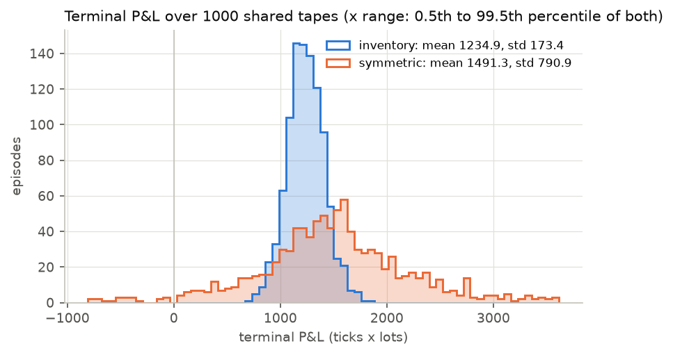
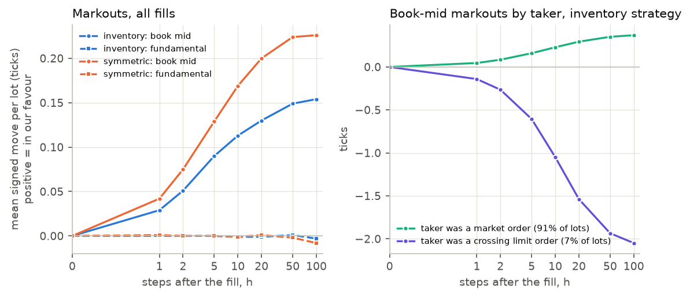
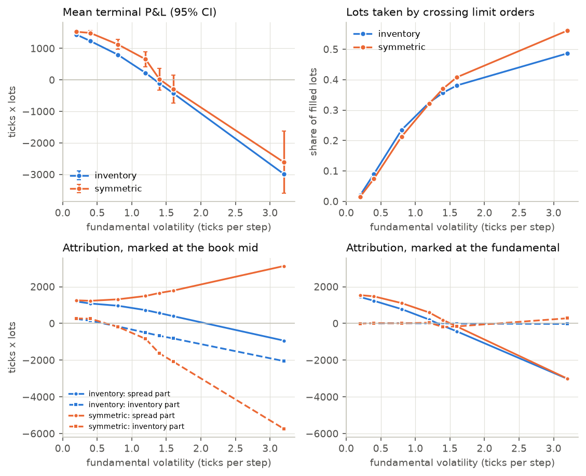

<h1 align="center">Limit Order Book and Matching Engine</h1>

<p align="center"><b>A price-time priority matching engine in C++20, benchmarked across four data-structure designs, with Python bindings and an Avellaneda-Stoikov market maker trading against simulated flow in the real book.</b></p>

<p align="center">
  <a href="https://github.com/DangKartik/limit-order-book-matching-engine/actions/workflows/tests.yml"></a>
  
  
  
  
  
</p>

**Topics:** limit order book · matching engine · price-time priority · C++20 templates · object pools · intrusive lists · benchmarking · tail latency · AddressSanitizer · differential testing · pybind11 · market making · Avellaneda-Stoikov · adverse selection

The engine matches limit and market orders with cancels and partial fills. I wrote the matching logic once, as a class template, and compiled it against four combinations of data structures so that a hand-written benchmark harness could measure what each choice is worth. A Python market maker then quotes in the real book while a synthetic tape of orders trades against it. The full reasoning is in [docs/DESIGN_NOTES.md](docs/DESIGN_NOTES.md) (33 numbered entries); this README is the summary.

<table>
<tr>
<td width="50%"></td>
<td width="50%"></td>
</tr>
<tr>
<td align="center"><sub>Terminal P&amp;L over 1000 shared tapes: inventory skew vs symmetric quoting</sub></td>
<td align="center"><sub>Markouts: mid-marked gains vanish at the fundamental</sub></td>
</tr>
</table>

## Key results

| | Result |
|---|---|
| **Is the matching correct?** | 157 C++ tests pass in Release and under AddressSanitizer + UBSan, including a differential test of 100,000 random operations against a deliberately naive reference book, run on all four implementations. 49 Python tests cover the bindings and simulator. |
| **What do the data structures buy?** | A flat tick-indexed array of levels plus an intrusive list over an object pool runs **1.66x to 2.60x** the throughput of the `std::map` + `std::list` baseline (dense book: **31.5 ns per operation**, 31.7M ops/s; p99.9 latency 209 to 167 ns). |
| **Does the market maker reproduce the paper?** | Yes. With no book, the model matches Avellaneda and Stoikov (2008), Tables 1 to 3, e.g. inventory strategy at gamma = 0.1: profit 64.90 vs 65.0, std 6.54 vs 6.6. |
| **Does inventory skew pay in the real book?** | Not in mean P&L. Over 1000 paired tapes it earns **256.4 less** than symmetric quoting (95% CI [-303.3, -209.4]) but with a P&L std of 173 vs 791 and no losing episodes (vs 3.1%): a risk trade, not an edge. |
| **Where does it break?** | Its mid-marked inventory P&L (146.4) vanishes when marked at the fundamental (-3.0). It stops making money between 1.2 and 1.4 ticks per step of fundamental volatility, as crossing limit orders take a growing share of fills. |

**Read this first.** All flow is synthetic and mostly uninformed, with no fees, competitors or latency beyond one step, so the market-making numbers are properties of a simulator, not trading results. Benchmarks come from one machine (Apple M5, Apple clang 21) with a 42 ns clock tick, and no profiler was used to confirm the cache and allocator explanations.

**Build history:** the work was done in five stages, each tagged (`stage-1` core engine, `stage-2` data structures and benchmark harness, `stage-3` pybind11 bindings, `stage-4` market maker, `stage-5` write-up).

## Quick start

Prerequisites: macOS with the Xcode command line tools (`xcode-select --install`),
CMake 3.25 or newer, and Python 3 for the bindings. The first configure needs
network access, because CMake fetches pinned versions of GoogleTest (v1.17.0)
and pybind11 (v3.0.4). I have only built this on macOS with Apple clang; CI builds and tests it on macOS on every push. All
commands run from the repository root.

```sh
# Release build (the default build type), tests, and the benchmark
cmake -S . -B build -DCMAKE_BUILD_TYPE=Release
cmake --build build -j
ctest --test-dir build                 # or ./build/tests/lob_tests for GoogleTest output
./build/bench/lob_bench                # full run: 3 scenarios x 4 implementations
./build/bench/lob_bench --scenario dense --ops 200000 --repeats 3 --csv /tmp/lob_bench.csv   # quicker

# Sanitizer build: AddressSanitizer + UndefinedBehaviorSanitizer, Debug (asserts on)
cmake -S . -B build-asan -DCMAKE_BUILD_TYPE=Debug -DLOB_SANITIZE=ON
cmake --build build-asan -j
ctest --test-dir build-asan

# Python module: needs a virtual environment; writes python/pylob.cpython-*.so
python3 -m venv .venv
.venv/bin/pip install -r requirements.txt
cmake -S . -B build -DLOB_BUILD_PYTHON=ON -DPython_EXECUTABLE="$PWD/.venv/bin/python"
cmake --build build -j
.venv/bin/python -m pytest python/tests
.venv/bin/python python/bench_bindings.py   # Python per-call overhead

# Market-making analysis: rewrites results/mm/ (see "Market-making simulation")
PYTHONPATH=python .venv/bin/python python/run_analysis.py
```

On my machine, from clean build directories, 157 of 157 C++ tests passed in
the Release build and in the sanitizer build; 49 of 49 Python tests pass.
`lob_bench` warns if it is not a Release build. Never combine `LOB_BUILD_PYTHON`
with `LOB_SANITIZE`: a sanitized module cannot be loaded by a normal Python.

## Usage

### C++

The engine is header-only; add `include/` to the include path (or link the
`lob` CMake target).

```cpp
#include <cstdio>
#include <vector>

#include "lob/order_book.hpp"

int main() {
    lob::FlatPoolBook book(lob::BookConfig{.min_price = 1, .max_price = 20'000});
    std::vector<lob::Trade> trades;   // caller-owned; the engine appends, never clears

    book.add_limit(lob::Side::Sell, 101, 5, trades);                              // id 1 rests
    book.add_limit(lob::Side::Sell, 102, 5, trades);                              // id 2 rests
    const lob::OrderResult bid = book.add_limit(lob::Side::Buy, 99, 10, trades);  // id 3 rests

    trades.clear();
    const lob::OrderResult r = book.add_limit(lob::Side::Buy, 102, 7, trades);
    // trades now holds 5 at 101 against id 1, then 2 at 102 against id 2.

    book.cancel(bid.id);   // true; the bid side is now empty
    std::printf("filled %lld, trades %zu, best ask %lld\n", static_cast<long long>(r.filled),
                trades.size(), static_cast<long long>(*book.best_ask()));   // filled 7, trades 2, best ask 102
}
```

This compiles without warnings under `c++ -std=c++20 -Wall -Wextra -Wpedantic -Wconversion -Wshadow -I include`.

### Python

```python
import pylob
from pylob import Side

book = pylob.OrderBook(min_price=1, max_price=20_000)   # FlatPoolBook underneath
book.add_limit(Side.Sell, 101, 5)
book.add_limit(Side.Sell, 102, 5)
result, trades = book.add_limit(Side.Buy, 102, 7)   # returns (OrderResult, list of Trade)

print(result)                     # OrderResult(id=3, filled=7, resting=0)
print(trades[0])                  # Trade(maker_id=1, taker_id=3, price=101, qty=5, taker_side=Side.Buy)
print(book.best_bid(), book.best_ask())   # None 102
print(book.depth(Side.Sell, max_levels=5))   # [LevelView(price=102, qty=3, order_count=1)]
```

The module is not installed; run scripts with `PYTHONPATH=python .venv/bin/python script.py`
(pytest finds it through [python/conftest.py](python/conftest.py)). Note that
`pylob.OrderBook` is the optimised `FlatPoolBook`, while the C++ alias
`lob::OrderBook` is still the baseline `MapListBook`; `pylob.BaselineOrderBook` is the baseline.

## Architecture

### Matching rules

- **Price-time priority**: best opposite price first, oldest order first within a price.
- **Trades print at the maker's price**: a buy limit at 105 against a resting
  ask at 100 trades at 100 ([#9](docs/DESIGN_NOTES.md#9-trades-print-at-the-makers-price)).
- **Partial fills**: a partly filled maker keeps its place at the front of its
  queue; a partly filled limit taker rests its remainder at its limit price.
- **Market orders** sweep until filled or the side is empty; the remainder is
  dropped, never rested ([#10](docs/DESIGN_NOTES.md#10-market-orders-are-limit-orders-at-the-extreme-price-that-never-rest)).
- **Cancel** by id returns false if the id is unknown, filled or already cancelled.
- **Rejections are results, not exceptions**: `qty <= 0` and limit prices
  outside `BookConfig` (default 1 to 100,000 ticks) come back with a reason code
  and id 0 ([#12](docs/DESIGN_NOTES.md#12-input-validation-and-what-is-not-validated)).
- Ids are assigned from 1 and rejected orders do not consume one. Prices and
  quantities are `int64_t` ticks and units; there is no floating point in the engine.

### Data structures

Each side of `BasicOrderBook<Queue, LevelsT>` is a `LevelsT` container of
`Level { Queue queue; Quantity total_qty; }`; a shared index maps order ids to
handles into the queues.

| Part | Baseline | Optimisation | Why |
|---|---|---|---|
| Price levels, per side | `std::map` with a `BetterPrice<Side>` comparator, so `begin()` is the best price on both sides | `FlatLevels`: a vector slot for every tick in the configured range, plus the index of the best non-empty slot | O(log L) tree walk versus one subtraction and an array index |
| Queue within a level | `std::list<Order>` | `IntrusiveQueue`: hand-written doubly linked list over `OrderPool` (chunks of 4,096 nodes, LIFO free list) | removes the `malloc`/`free` per order |
| Cancel index | `std::unordered_map<OrderId, Handle>`; the handle is a list iterator or a node pointer | same in all four | stable handles give O(1) removal from the middle of a queue |
| Trade output | caller-owned `std::vector<Trade>&`, appended to | same | a reused vector stops allocating after warm-up ([#6](docs/DESIGN_NOTES.md#6-trades-are-appended-to-a-caller-owned-buffer)) |

The cached `total_qty` means `quantity_at()` and `depth()` do not walk the
queue. Empty levels are removed in the operation that empties them, so the best
level always holds real liquidity ([#11](docs/DESIGN_NOTES.md#11-empty-levels-are-erased-immediately)).

### Selecting an implementation at compile time

`BasicOrderBook<Queue, LevelsT>` is a class template; `LevelsT` is a template
template parameter that the book instantiates once per side. Four aliases in
[include/lob/order_book.hpp](include/lob/order_book.hpp) name the combinations:

| Alias | Levels | Queue | Used by |
|---|---|---|---|
| `MapListBook` (= `lob::OrderBook`) | `std::map` | `std::list` | baseline; `pylob.BaselineOrderBook` |
| `MapPoolBook` | `std::map` | intrusive + pool | benchmark, tests |
| `FlatListBook` | flat array | `std::list` | benchmark, tests |
| `FlatPoolBook` | flat array | intrusive + pool | fastest measured; `pylob.OrderBook` |

There are no virtual functions. Each level container exposes a cheap `Cursor`
(a map iterator or an array index), so matching does one lookup per operation ([#15](docs/DESIGN_NOTES.md#15-one-matching-engine-four-data-structure-combinations-chosen-at-compile-time)).

### Repository layout

| Path | Contents |
|---|---|
| [include/lob/](include/lob/) | the engine: `types.hpp` (vocabulary), `order_book.hpp` (`BasicOrderBook` and the four aliases), `price_levels.hpp` (`MapLevels`, `FlatLevels`), `order_queue.hpp` (`ListQueue`, `OrderPool`, `IntrusiveQueue`) |
| [tests/](tests/) | scenario tests, differential test, `ReferenceBook`, pool tests |
| [bench/](bench/) | `bench_main.cpp` (harness), `order_stream.hpp` (synthetic stream) |
| [bindings/pylob.cpp](bindings/pylob.cpp) | pybind11 module `pylob` |
| [python/mm/](python/mm/) | market-making simulator: `avellaneda_stoikov.py` (formulas), `flow.py` (background tape), `market_maker.py` (quoting and accounting), `simulate.py` (one episode), `pure_model.py` (model without a book), `analysis.py` (calibration, attribution, markouts) |
| [python/run_analysis.py](python/run_analysis.py) | runs every stage 4 experiment and writes `results/mm/` |
| [python/tests/](python/tests/) | binding, simulator and analysis tests; [python/bench_bindings.py](python/bench_bindings.py) times the bindings |
| [results/](results/) | saved outputs: `bench_stage2.txt` and `.csv`; `mm/` holds `report.txt`, `summary.json` and eight figures |
| [docs/DESIGN_NOTES.md](docs/DESIGN_NOTES.md) | design rationale, entries #1 to #33 |

## Design decisions and trade-offs

| Decision | Alternative I rejected | Trade-off | Notes |
|---|---|---|---|
| Integer tick prices (`int64_t`) | `double` | exact equality and hashing, array indexing; caller converts display prices | [#1](docs/DESIGN_NOTES.md#1-prices-are-integer-ticks-int64_t) |
| Signed quantities | `uint64_t` | an arithmetic bug goes negative and is caught, instead of wrapping to a valid-looking number | [#2](docs/DESIGN_NOTES.md#2-quantities-are-signed) |
| `std::map` levels as baseline | sorted vector, `unordered_map` | ordered and unbounded, O(log L), but one heap node per level | [#3](docs/DESIGN_NOTES.md#3-price-levels-stdmapprice-level-baseline) |
| `std::list` queue as baseline | `deque`, vector with tombstones | the only standard container with FIFO, O(1) middle erase and stable iterators; one allocation per order | [#4](docs/DESIGN_NOTES.md#4-queue-within-a-level-stdlistorder-baseline) |
| Hash-map cancel index | scan the book, `std::map`, vector by id | average O(1) cancel; still allocates a node per resting order | [#5](docs/DESIGN_NOTES.md#5-cancel-lookup-stdunordered_maporderid-list-iterator) |
| Caller-owned trade buffer | return a vector, per-trade callback | no allocation in steady state; caller must remember to clear | [#6](docs/DESIGN_NOTES.md#6-trades-are-appended-to-a-caller-owned-buffer) |
| Book is non-copyable and non-movable | compiler-generated copy | a copy would hold iterators into the original book; deleting it makes that a compile error | [#8](docs/DESIGN_NOTES.md#8-orderbook-is-non-copyable-and-non-movable) |
| Market order = limit at `INT64_MAX`/`INT64_MIN` that never rests | separate loop or an `is_market` branch | one matching loop; the sentinel is only compared, never stored | [#10](docs/DESIGN_NOTES.md#10-market-orders-are-limit-orders-at-the-extreme-price-that-never-rest) |
| Templates for the four variants | virtual base class, `#ifdef`, two classes | zero runtime cost and a 2x2 experiment; harder to read, header-only, interface checked only by compilation | [#15](docs/DESIGN_NOTES.md#15-one-matching-engine-four-data-structure-combinations-chosen-at-compile-time) |
| Intrusive list over a pool | `std::pmr::list`, index-based vector pool | no `malloc` per order; hand-written pointer code; memory stays at its high-water mark | [#16](docs/DESIGN_NOTES.md#16-queue-optimisation-intrusive-doubly-linked-list-over-an-object-pool) |
| Flat array of levels | pooled map, bitmap of occupied slots | O(1) level access; bounded price range, 32 bytes per tick per side, O(gap) scan when the best level empties | [#17](docs/DESIGN_NOTES.md#17-level-optimisation-flat-array-indexed-by-tick) |
| Hand-written benchmark harness | Google Benchmark | per-operation tail latency on a stateful replay; I own its mistakes, so it checks itself | [#18](docs/DESIGN_NOTES.md#18-a-hand-written-benchmark-harness) |
| pybind11, binding outside the engine | ctypes/cffi, Cython, a Python reimplementation | automatic type conversion; slow to compile; module tied to one Python version | [#21](docs/DESIGN_NOTES.md#21-pybind11-with-the-binding-layer-kept-outside-the-engine) |
| Python API returns trades | mirror the C++ buffer API | each call self-contained; Python allocates anyway, C++ side still does not | [#22](docs/DESIGN_NOTES.md#22-the-python-api-returns-trades-instead-of-taking-a-buffer) |
| Background flow drawn up front as a tape, shared by both strategies | background traders that react to the book; independent seeds | paired comparison on identical flow; the background never reacts to the market maker | [#23](docs/DESIGN_NOTES.md#23-an-exogenous-tape-and-common-random-numbers) |
| Background orders priced off a hidden fundamental | price off the book mid; scripted informed traders | a true value to mark against, and adverse selection comes out of matching; market orders carry no information | [#24](docs/DESIGN_NOTES.md#24-background-orders-are-priced-off-a-hidden-fundamental) |
| Conservative quoting: background mid, outward rounding, always passive, keep queue position | full-book mid, nearest tick, aggressive inventory dumping, requote every step | never pays the spread or chases its own quotes; wider quotes and fewer fills than the model asks for | [#25](docs/DESIGN_NOTES.md#25-how-the-market-maker-quotes) |
| gamma from a stated rule (5 lots shift the reservation price by 0.75 ticks at t = 0) | the paper's gamma; tuning | easy to reason about in ticks; not the best mean/std on the grid | [#26](docs/DESIGN_NOTES.md#26-units-and-mapping-the-models-parameters-onto-steps-and-ticks) |
| Mark at the book mid with an exact spread/inventory split, and again at the fundamental | last trade price; round-trip attribution | every tick traceable; the mid-marked split alone misleads | [#27](docs/DESIGN_NOTES.md#27-mark-to-market-and-the-exact-pl-attribution) |
| Fill curve fitted where the market maker quotes (1 to 3 ticks) | fitting the tail | matches the quoting range; circular, and ignores queue position | [#28](docs/DESIGN_NOTES.md#28-calibrating-the-fill-curve-and-what-the-calibration-ignores) |
| Symmetric benchmark with the same time-varying spread | the paper's constant spread | isolates the skew exactly; differs from the paper at gamma = 1 | [#29](docs/DESIGN_NOTES.md#29-the-pure-model-reproduces-the-paper-and-one-difference-in-the-benchmark) |

## Benchmark results

### Method

[bench/bench_main.cpp](bench/bench_main.cpp) generates each scenario's order
stream once, outside any timed region, and replays the same operations through
all four books ([#18](docs/DESIGN_NOTES.md#18-a-hand-written-benchmark-harness)).

- **Two kinds of pass.** A throughput pass timestamps only the two ends of the
  2,000,000 measured operations. A separate latency pass timestamps every
  operation and reports nearest-rank percentiles, so every number was observed.
- **Checksum cross-check.** Trade count, filled quantity, successful cancels and
  final order count must be identical for all four implementations, in both
  passes, or the run aborts.
- **Interleaved runs** (A B C D, A B C D, ...) spread thermal drift on a fanless
  laptop over all implementations. Throughput is the **median of 7** runs (min
  and max in the CSV; in the saved run the spread within any one implementation
  was under 2%). The harness measures and prints its own clock tick and call cost.

The stream is synthetic ([#19](docs/DESIGN_NOTES.md#19-the-synthetic-order-stream)):
a slowly random-walking mid, limit orders at a geometric distance from it (10%
priced through the mid), uniform random cancels of live orders, 5% market
orders, and a controller that holds the book near a target depth.

| Scenario | Resting orders | Mean distance from mid | Mix (limit / cancel / market) | Purpose |
|---|---|---|---|---|
| dense | 10,000 | 10 ticks | 64.3 / 30.6 / 5.0 % | many orders on few levels |
| deep | 100,000 | 50 ticks | 63.8 / 31.3 / 5.0 % | a book that does not fit in the fast caches |
| sparse | 2,000 | 1,000 ticks | 54.0 / 41.0 / 5.0 % | few orders on far-apart levels; meant as the flat array's worst case |

### Results

Release build (`-O3 -DNDEBUG`), Apple M5 MacBook Air, Apple clang 21. The numbers
are copied from [results/bench_stage2.txt](results/bench_stage2.txt) and
[results/bench_stage2.csv](results/bench_stage2.csv), which also hold
per-operation-type percentiles. Throughput, million operations per second (ns
per operation in brackets, derived from throughput, so no clock reads inside):

| Scenario | map+list (baseline) | map+pool | flat+list | flat+pool | flat+pool vs baseline |
|---|---|---|---|---|---|
| dense | 18.73 (53.4) | 22.51 (44.4) | 23.32 (42.9) | 31.70 (31.5) | 1.69x |
| deep | 13.73 (72.8) | 16.36 (61.1) | 17.87 (56.0) | 22.84 (43.8) | 1.66x |
| sparse | 13.24 (75.5) | 14.35 (69.7) | 26.77 (37.4) | 34.42 (29.1) | 2.60x |

Latency over all operations, ns (p50 / p90 / p99 / p99.9; every value is a
multiple of the ~42 ns clock tick):

| Scenario | map+list | map+pool | flat+list | flat+pool |
|---|---|---|---|---|
| dense | 42 / 83 / 125 / 209 | 42 / 83 / 125 / 167 | 42 / 42 / 125 / 209 | 41 / 42 / 84 / 167 |
| deep | 83 / 84 / 208 / 292 | 42 / 84 / 167 / 250 | 42 / 84 / 167 / 292 | 42 / 83 / 167 / 250 |
| sparse | 83 / 84 / 167 / 292 | 42 / 84 / 166 / 250 | 41 / 42 / 166 / 250 | 41 / 42 / 125 / 167 |

### What the results show

- **Both optimisations help in every scenario, and they combine.** In dense the
  pool alone gives 1.20x and the flat array alone 1.25x; together 1.69x, more
  than the product of the two (1.50x).
- **The flat array matters most when there are many levels.** In sparse it
  alone gives 2.02x: the map holds on the order of a thousand levels per side,
  and every add and cancel walks that tree. In dense the map is small and its
  top stays in cache, so the gain is 1.25x.
- **The pool's gain is steadier**: 1.08x to 1.20x on its own, 1.28x to 1.36x on
  top of the flat array, where a fixed saving is a bigger share of the operation.
- **A bigger book is slower for every implementation**: the baseline goes from
  53.4 to 72.8 ns per operation between dense and deep; the shared cancel index
  is a likely part of that.
- **The tail improves by about one clock tick**, for example p99.9 from 209 to
  167 ns in dense and from 292 to 167 ns in sparse. The clock cannot resolve more.

**What surprised me.** I expected the flat array to lose in the sparse scenario,
because when the best level empties it scans slot by slot for the next one. It
won by its largest margin there. Unprofiled reasoning that fits the numbers:
the scan only runs when the best level empties, reads memory sequentially
(which the prefetcher handles well), and usually finds the next slot close by
because orders cluster near the mid, while the map pays its tree walk on every
add and cancel. A workload that emptied the best level on most operations, with
gaps of thousands of ticks, would reverse the result; a bitmap of occupied
slots is the fix I would try ([#20](docs/DESIGN_NOTES.md#20-results)).

### Measurement limits

- **Coarse clock.** `steady_clock` on this machine ticks every 41.67 ns (a
  24 MHz timer). A typical operation takes 30 to 75 ns, about one tick, so **the
  p50 column cannot rank the implementations; only the throughput-derived ns/op
  can.** The tail columns are coarse but meaningful.
- **Each latency sample includes two clock reads**, measured at 15.5 ns per read
  in the saved run (15 to 24 ns across runs). They are not subtracted.
- **The max column is OS noise**: one worst sample out of 2,000,000, 13.9 to
  19.0 microseconds for every implementation. I left it out of the tables above.
- **One machine, one compiler, synthetic flow.** macOS cannot pin a thread to a
  core (the harness requests the user-interactive QoS class). The stream trades
  far more often than a real market and is not bursty, so the results describe
  these data structures on this stream, not the engine on a real feed.
- **No profiler or hardware counters were used.** The cache and allocator
  explanations above fit the numbers, but I did not observe them directly.

### Python per-call overhead

[python/bench_bindings.py](python/bench_bindings.py) times a Python loop of
1,000,000 limit orders with some cancels: about 390 ns per iteration with
`pylob.OrderBook` and 410 ns with `pylob.BaselineOrderBook` (best of 5, run
recorded in [#22](docs/DESIGN_NOTES.md#22-the-python-api-returns-trades-instead-of-taking-a-buffer);
a re-run while writing this README gave 404 and 423 ns). The engine work is tens
of nanoseconds, so roughly nine tenths of each call is the interpreter and the
conversion layer. Anything latency-sensitive belongs in C++.

## Testing

All 157 C++ tests are GoogleTest typed or plain tests in one binary,
`lob_tests`, registered with CTest; the 49 Python tests run under pytest.

| Test | File | What it checks |
|---|---|---|
| Scenario tests | [tests/order_book_test.cpp](tests/order_book_test.cpp) | 37 hand-written cases, one rule each: FIFO within a level, better price beats earlier time, maker-price trades, partial fills keep priority, sweeps stop at the limit, market remainder is dropped, cancel from the middle of a queue, rejections, depth, wide price gaps, invalid config |
| Differential test | [tests/differential_test.cpp](tests/differential_test.cpp) | 20,000 random operations for each of 5 seeds through the engine and [tests/reference_book.hpp](tests/reference_book.hpp), a deliberately naive flat-vector book; results, trades, best prices and order counts must match after every operation, full depth every 100 operations, and the book must never be crossed. It also requires over 1,000 trades and 1,000 successful cancels so it cannot pass vacuously |
| Typed across implementations | both files above | every scenario test and the differential test run against all four books (37 x 4 + 1 x 4 = 152 tests) |
| Pool tests | [tests/order_pool_test.cpp](tests/order_pool_test.cpp) | 5 tests: LIFO reuse, growth by whole chunks, pointers stay valid when the pool grows, steady churn does not grow the pool, intrusive erase at head, middle and tail |
| Sanitizers | `-DLOB_SANITIZE=ON` | the same 157 tests under AddressSanitizer and UndefinedBehaviorSanitizer in a Debug build with asserts enabled |
| Python bindings | [python/tests/test_pylob.py](python/tests/test_pylob.py) | 23 tests: type conversion (`None`, lists, enums), `ValueError` and `TypeError` mapping, trades from one call not leaking into the next, and a 20,000-operation random stream through both bound books with identical results |
| Simulator | [python/tests/test_mm.py](python/tests/test_mm.py) | 17 tests: the quoting formulas (spread value at the paper's parameters, long inventory lowers both quotes, both strategies quote equal spreads); the tape is deterministic in its seed and unchanged by running a strategy on it; on a hand-built book, the background touch excludes the market maker's own quote, quotes round outwards and stay passive, an unchanged quote keeps its order id, partial fills are booked correctly; on a whole episode, the P&L split holds bit for bit, inventory and cash match the fills, and an independent audit subclass confirms the market maker is never the taker and never has two orders on one side; with no market maker there is no inventory, and a rerun on the same seed is identical |
| Analysis helpers | [python/tests/test_analysis.py](python/tests/test_analysis.py) | 9 tests: the exponential fit recovers a known curve, including from synthetic reach data with empty steps; markout sign convention; attribution sums to P&L at the mid and at the fundamental; each fill's taker type is read correctly from the tape; quote distances use the mid the quote was set against; the paper's constant-spread benchmark uses the average spread |

The differential test has a known limit: I wrote both books from the same
understanding of the rules, so it catches implementation bugs, not a
misunderstanding of the rules; the scenario tests pin the rules
([#13](docs/DESIGN_NOTES.md#13-testing-strategy-scenario-tests-plus-a-differential-test)).
The benchmark's checksum cross-check adds a coarser check on millions of operations.

## Market-making simulation

A Python Avellaneda-Stoikov market maker quotes in the real C++ book through
`pylob`. Units: prices in ticks, quantities in lots, P&L in ticks x lots. Every
number is copied from [results/mm/report.txt](results/mm/report.txt) or
[results/mm/summary.json](results/mm/summary.json); the reasoning is in
[#23 to #33](docs/DESIGN_NOTES.md#stage-4-market-making-simulator). **These are
properties of a simulator, not trading results**: the flow is synthetic and
mostly uninformed, with no fees, no competitors and no latency beyond one step.

### How it works

A hidden fundamental follows a Gaussian random walk (0.4 ticks per step) over
2000 measured steps after 200 warm-up steps. [python/mm/flow.py](python/mm/flow.py)
draws an episode's background orders up front from one seed: limit orders a
geometric number of ticks (mean 8) either side of the fundamental, each with a
cancel time, and market orders whose side is a coin flip. When this tape is
replayed through a fresh `pylob.OrderBook` ([python/mm/simulate.py](python/mm/simulate.py)),
new limit orders are priced through stale quotes, so adverse selection comes
out of matching, not a rule ([#24](docs/DESIGN_NOTES.md#24-background-orders-are-priced-off-a-hidden-fundamental)).
The tape ignores the book, so both strategies face identical orders on each
seed ([#23](docs/DESIGN_NOTES.md#23-an-exogenous-tape-and-common-random-numbers)).

At the end of each step [python/mm/market_maker.py](python/mm/market_maker.py)
takes the model's quotes around the mid of the *background* touch (excluding
its own orders), rounds them outwards to whole ticks, clamps them to stay
passive, keeps a quote whose price is unchanged (and with it its queue
position), and otherwise cancels and reposts 5 lots. New quotes meet the next
step's flow, so it reacts one step late ([#25](docs/DESIGN_NOTES.md#25-how-the-market-maker-quotes)).
With mid s, inventory q, risk aversion gamma, volatility sigma, fill-curve
decay k and time left T - t:

```
reservation price   r         = s - q * gamma * sigma^2 * (T - t)
total spread        ask - bid = gamma * sigma^2 * (T - t) + (2 / gamma) * ln(1 + gamma / k)
```

The **inventory** strategy centres this spread on r, so a long position lowers
both quotes; the **symmetric** strategy centres it on the mid. T = 1 episode,
sigma = 17.8885 ticks per square-root episode (the true value), k = 0.7094 per
tick (fitted from the book without the market maker), and gamma = 0.00046875,
set so that 5 lots shift r by 0.75 ticks at t = 0 ([#26](docs/DESIGN_NOTES.md#26-units-and-mapping-the-models-parameters-onto-steps-and-ticks)).
After rounding, the model's 2.9684-tick spread becomes 3.872 on average
(inventory) and 3.481 (symmetric).

### Sanity check: the pure model against the paper

[python/mm/pure_model.py](python/mm/pure_model.py) runs the model with no book
at the paper's parameters (s0 = 100, T = 1, sigma = 2, dt = 0.005, k = 1.5,
A = 140), 20,000 paths per row against the paper's 1000. Cells are ours / paper;
the paper is Avellaneda and Stoikov (2008), Quantitative Finance 8(3), Tables 1
to 3, pp. 222 to 223 ([author's copy](https://math.nyu.edu/~avellane/HighFrequencyTrading.pdf)).

| gamma | strategy | spread | profit | std of profit | std of final q |
|---|---|---|---|---|---|
| 0.1 | inventory | 1.49 / 1.49 | 64.90 / 65.0 | 6.54 / 6.6 | 2.91 / 2.9 |
| 0.1 | symmetric | 1.49 / 1.49 | 67.96 / 68.4 | 13.12 / 12.7 | 8.42 / 8.4 |
| 0.01 | inventory | 1.35 / 1.35 | 68.43 / 68.6 | 8.96 / 8.7 | 5.17 / 5.1 |
| 0.01 | symmetric | 1.35 / 1.35 | 68.60 / 68.8 | 13.55 / 12.8 | 8.73 / 8.7 |
| 1.0 | inventory | 3.03 / 3.02 | 31.49 / 31.4 | 4.84 / 5.0 | 1.63 / 1.7 |
| 1.0 | symmetric | 3.03 / 3.02 | 43.99 / 44.0 | 9.60 / 11.0 | 5.83 / 5.1 |

The largest difference is the dispersion in the gamma = 1 symmetric row: the
paper's benchmark quotes a *constant* spread (the inventory strategy's time
average), mine the same *time-varying* spread, which isolates the skew. Run the
paper's way it gives 10.65 and 5.15 ([#29](docs/DESIGN_NOTES.md#29-the-pure-model-reproduces-the-paper-and-one-difference-in-the-benchmark)).

### Headline: inventory skew against symmetric quoting, 1000 shared tapes

| | inventory (Avellaneda-Stoikov) | symmetric |
|---|---|---|
| terminal P&L, mean (s.e.) | 1234.9 (5.5) | 1491.3 (25.0) |
| terminal P&L, std | 173.4 | 790.9 |
| mean / std | 7.122 | 1.885 |
| 5th percentile of P&L | 963.0 | 229.4 |
| fraction of losing episodes | 0.0 | 0.031 |
| time-average abs(inventory) | 4.47 | 33.78 |
| terminal inventory std | 16.1 | 64.1 |
| fills per episode | 275.2 | 315.8 |

Paired on the same tape, inventory minus symmetric P&L is -256.4 (s.e. 24.0,
95% CI [-303.3, -209.4]). **The inventory strategy does not make more money; it
gives up mean P&L for much lower risk.** The symmetric strategy quotes tighter,
fills more, and carries inventory in a market that does not punish it
([#30](docs/DESIGN_NOTES.md#30-results-inventory-strategy-vs-symmetric-in-the-order-book-simulator)).


*Over the same tapes the inventory strategy's P&L is narrow; the symmetric one's is centred higher and reaches below zero.*

### What the experiments show

**(a) The default market is benign for a market maker.** Uninformed market
orders take 0.9113 of the inventory strategy's filled lots. They push the book
mid against it while the fundamental stays put, and the mid then reverts 0.369
ticks in its favour within 100 steps: that is the positive mid-marked inventory
P&L (146.4, s.e. 3.6), which vanishes when marked at the fundamental (-3.0,
s.e. 3.5). Limit orders priced through a stale quote (0.0678 of lots) are the
real adverse selection: the mid then moves 2.049 ticks against it ([#31](docs/DESIGN_NOTES.md#31-adverse-selection-why-the-market-maker-wins-here-and-where-it-stops)).


*Mid markouts are positive while fundamental markouts are flat; market-order fills gain, crossing-limit fills lose.*

**(b) It stops making money between 1.2 and 1.4 ticks per step.** With k
re-calibrated and gamma fixed (400 tapes per point), the inventory strategy
earns 222.2 (s.e. 10.7) at 1.2 and -111.1 (s.e. 13.1) at 1.4, as the share of
lots taken by crossing limit orders grows (0.0194 at 0.2, 0.4864 at 3.2).
Marked at the mid the losses look like inventory losses; at the fundamental
they are spread losses taken at the fill.


*P&L against fundamental volatility, the crossing-limit share, and the two marks disagreeing.*

**(c) The pure model overstates P&L about threefold, through volume.** With
matched parameters it earns 3638.8 against the book's 1234.9, at a similar P&L
per filled lot (1.283 against 1.333). Fill probability per side per step falls
from 0.1418 (pure) to 0.0996 at the book's rounded quote distances to 0.0652
realised, and a book fill averages 3.367 lots, not 5 ([#32](docs/DESIGN_NOTES.md#32-the-order-book-simulator-against-the-pure-model-with-matched-parameters)).

**(d) The calibrated fill curve overstates fills and is not one exponential.**
Realised fill frequency is 0.484 to 0.855 of the fitted curve over 1 to 3
ticks, most likely from queueing behind background orders; the curve's local
slope rises from 0.298 per tick near the touch to about 1 further out
([#28](docs/DESIGN_NOTES.md#28-calibrating-the-fill-curve-and-what-the-calibration-ignores)).

**(e) Inventory control fades at the end of the horizon.** The skew falls to
zero with T - t, so the std of inventory across tapes, 4.82 on average over
steps 500 to 1499, reaches 16.07 at the last step.

**(f) The default gamma is not the best mean/std on the grid**: 6.758 at the
default against 7.110 at twice it, on 500 tapes per point ([#33](docs/DESIGN_NOTES.md#33-risk-aversion-the-end-of-the-episode-and-limitations)).

Other figures: [an example episode](results/mm/fig1_example_episode.png), [fill curve](results/mm/fig4_calibration.png) (d),
[pure model against book](results/mm/fig5_pure_vs_book.png) (c), [inventory std over time](results/mm/fig3_inventory_std_over_time.png) (e),
[risk-aversion frontier](results/mm/fig6_gamma_frontier.png) (f).

**Reproducing.** `PYTHONPATH=python .venv/bin/python python/run_analysis.py`,
after building the Python module. All seeds are fixed; the recorded run took
95.2 s in total with 10 worker processes. It overwrites `report.txt`,
`summary.json` and the eight figures in [results/mm/](results/mm/).

## Limitations and what I would do next

Engine, by design or for lack of time:

- **Single-threaded and single-instrument**, with no I/O, network protocol or
  persistence; the Python bindings hold the GIL for every call.
- **No self-trade prevention** (no notion of a participant), no modify (cancel
  and resubmit loses priority), no IOC/FOK, no hidden or iceberg orders, and
  engine-assigned ids only.
- **The flat book has a bounded price range**: 32 bytes per tick per side for
  the whole range (3.2 MB per side for the default 100,000 ticks), and it cannot
  follow a price that leaves it; all four books enforce the same range. Its
  best-level scan is O(gap in ticks) when the best level empties, harmless on my
  streams but exposed by a pathological one.
- **The cancel index still allocates** a `std::unordered_map` node per resting
  order, so the pool removes one of two allocations per order; the pool never
  returns memory to the system while the book lives.
- **Unchecked and implicit**: no overflow check on a level's total quantity (it
  would need more than 9e18 units at one price); the queue and level types
  agree on an interface that only compilation checks.
- **Measurement and packaging**: synthetic flow, one machine, a 42 ns clock, no
  profiler; built and tested only on macOS with Apple clang; the module is not
  pip-installable and is tied to one Python version (`pylob.cpython-314-darwin.so`).

Simulator ([#33](docs/DESIGN_NOTES.md#33-risk-aversion-the-end-of-the-episode-and-limitations)):

- **Mostly uninformed flow**: the only informed flow is limit orders reacting to
  a fundamental move; finding (b) shows how fast results turn as it grows.
- **No fees or rebates, no latency beyond one step, no competition**: the
  background never improves on, queues against or reacts to the market maker.
- **The market maker is given the true sigma**, and k is calibrated from a book
  without it. **The finite horizon** switches inventory control off at the end.
- **Synthetic everything**: the flow was tuned for a stable book and a few
  hundred fills per episode, not fitted to any real market.

Next steps, roughly in order:

1. Replace the `unordered_map` cancel index with a vector indexed by order id
   (ids are dense and engine-assigned), the obvious remaining shared cost.
2. Profile with Instruments and hardware counters to check the cache and allocator explanations.
3. A bitmap of occupied slots in `FlatLevels`, tested on a stream that empties the best level across wide gaps.
4. Informed market orders, a competing market maker, and fees in the simulator;
   the infinite-horizon model; sigma estimated online instead of given.
5. Replay real exchange data (for example Nasdaq ITCH) instead of synthetic streams.
6. Modify, IOC/FOK and self-trade prevention, each with scenario tests and a
   matching change to the reference book.
7. C++20 concepts for the queue and level interfaces; package the bindings with
   `pyproject.toml` and scikit-build-core.
